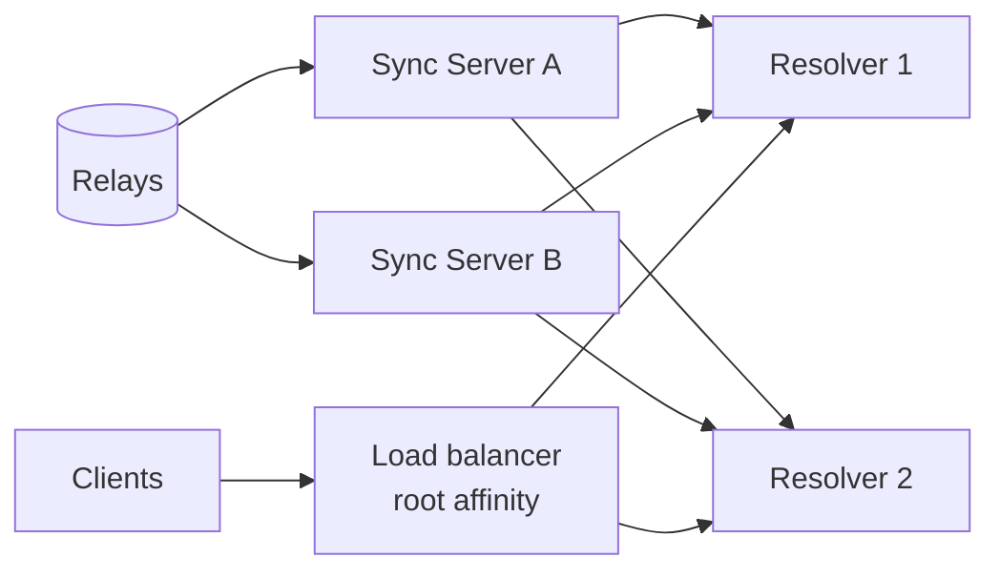

# Global Server — architecture

Status: **draft** · 2026-09-30

## Purpose

A public, multi-tenant Web-of-Trust resolver in Rust. It keeps a very large
WoT Graph heap **in memory**, built from every eligible `32009` / `32014`
statement and `10011` claim its whitelisted writers push in, and answers the
[resolver protocol](../../TrustGraph/specs/resolver-api.md) for any root, for
as many people as possible.

It answers the same questions as the extension and the Personal Server, with
the same rules ([wot-model.md](../../TrustGraph/specs/wot-model.md)) and the
same protocol. It is an optimization, not an oracle (AttentionX
`docs/design.md` § 8): every result carries source event ids that anyone can
check against signed events.

**Strictly a WoT graph.** Kinds `32009`, `32014`, `10011` only. No kind `0`
profiles, no X identity or post data, no identity evidence supplied by
clients. A result depends only on public signed events.

## Goals

1. **Same answers.** Pass the conformance corpus and nightly differential
   fuzzing against the TypeScript reference.
2. **As much graph in memory as possible.** About 12 bytes per edge for
   everything a walk touches, in one format for disk and RAM, so the whole
   walkable graph is resident whenever it fits; what does not fit loads by
   subject in one or two contiguous reads ([graph-engine.md](graph-engine.md)).
   Reads scale out by replication.
3. **Throughput.** Many concurrent roots and long-lived WebSocket
   connections; batch queries parallel across cores.
4. **Bounded work.** Hard time, degree, node, record, and memory guardrails;
   no query can take the server down.
5. **Standard ingest and auth.** Writers push with NIP-01 `EVENT` after
   NIP-42 `AUTH`, checked against a NIP-43 whitelist
   ([sync-server.md](sync-server.md)).
6. **Privacy by default.** No retention of which subjects a root queried.
7. **Verifiable.** Signed events served for every id the server cites.

## Non-goals

- Holding keys or signing for users.
- Connecting to relays itself (Sync Servers do that).
- Kind `0`, X display chrome (handles, avatars, post text), Bio or linking-post
  evidence, or any other external identity data. Clients decorate locally.
- Scraping X or calling X on behalf of users.
- A global rank, "reputation score", or anything presented as objective.
- Storing other Nostr kinds or acting as a general-purpose relay.

## Scale targets (provisional)

To be validated by benchmarks in increment G3; they size the design, not a
promise.

| Metric | Target |
| --- | --- |
| Fully resident graph | 1 B edges / 100 M nodes on a 32 GB machine (≈ 12 GB hot format + ≈ 1.4 GB core) |
| Disk-backed graph | 5 B edges / 400 M nodes on a 64 GB machine with 2 TB NVMe; hottest part resident, the rest paged in by subject |
| Warm batch (200 items, cached root field) | p50 2 ms, p99 25 ms |
| Cold subject (not resident) | ≈ 0.1–0.3 ms per subject, prefetched in parallel per batch |
| Cold root field build (`D = 4`, ≤ 1 M reached nodes) | Exact up to `completeDepth` within 250 ms, completed in the background |
| Concurrent WebSocket connections per replica | 50 000 |
| Sustained ingest | 20 000 events/s (signature verification in parallel) |
| Restart to serving | < 30 s at 1 B edges (memory-map segments + delta replay); working set warm again within minutes in the background |

## Components

```mermaid
flowchart LR
  writers["Whitelisted writers<br/>Sync Servers · routers"]
  clients[Clients]
  subgraph gs [dtp-global process]
    ws[WebSocket endpoint<br/>NIP-01: DTP · EVENT · AUTH · REQ]
    access[Access<br/>NIP-42 · NIP-43 whitelist]
    guard[Guardrails<br/>deadlines · budgets · memory]
    val[Validation pipeline<br/>parallel]
    store[(Event store<br/>RocksDB, signed winners)]
    writer[Graph writer<br/>delta in RAM]
    segs[(Graph store<br/>packed segments, mmap<br/>clustered by subject / author)]
    res_mgr[Residency<br/>pin · prefetch · warm-up]
    snap[Epoch publisher]
    graph[Graph snapshot<br/>segments + delta]
    fields[Root-field cache]
    res[Resolver pool<br/>rayon]
    binds[Hint + claim indexes]
  end

  writers -- "AUTH + EVENT" --> ws
  clients -- "DTP" --> ws
  ws --> access
  access -- "EVENT" --> val --> store --> writer --> snap --> graph
  writer -- "flush / merge" --> segs
  segs --> graph
  res_mgr --> segs
  binds --> writer
  access -- "DTP" --> guard --> res --> graph
  res -- "prefetch" --> res_mgr
  res --> fields
```

| Component | Spec |
| --- | --- |
| Ingest endpoint and Sync Servers | [sync-server.md](sync-server.md) |
| Graph store: packed format, tiered segments, residency, fast subject loading, epochs, restart, memory budget | [graph-engine.md](graph-engine.md) |
| Exact walk, root fields, prefetch, guardrails, batch plan | [resolver-engine.md](resolver-engine.md) |
| Validation, event store, write path, retention and warmth, root activation | [ingest-storage.md](ingest-storage.md) |
| Identity binding from `32009` hints and `10011` claims | [identity-bindings.md](identity-bindings.md) |
| Auth, limits, privacy, deployment, observability | [api-privacy-operations.md](api-privacy-operations.md) |

## Crates

Cargo workspace, Rust edition 2024, latest stable toolchain. Two binaries.

| Crate | Role |
| --- | --- |
| `dtp-model` | Ids, kinds, records, scope profiles, NIP-32009 / 32014 / 39 validation and normalization (mirrors `@dtp/trust-protocol`) |
| `dtp-graph` | Graph store: key tables, packed CSR segments (subject- and author-clustered), cold columns, delta, dead bits, flush and merge, residency (pin, prefetch, warm-up), hint and claim indexes, epochs |
| `dtp-resolve` | Exact walk, root fields, guardrails, rating overlay, path format, neighborhood, sync frontier (mirrors `@dtp/trust-graph` + `@dtp/trust-query`) |
| `dtp-store` | Event store trait + RocksDB implementation |
| `dtp-protocol` | NIP-01 framing, NIP-42 / NIP-43 / NIP-86 / NIP-11 types, `DTP` messages, checked against `TrustGraph/schemas` |
| `dtp-api` | axum WebSocket endpoint, access control, NIP-11 and NIP-86 over HTTP |
| `dtp-relay` | Relay pool, subscriptions, backfill, negentropy, cursors — used only by the Sync Server |
| `dtp-server` | Binary **`dtp-global`** (resolver): config, wiring, metrics |
| `dtp-sync-server` | Binary **`dtp-sync`** (Sync Server): relay pool + push to resolver endpoints |
| `dtp-conformance` | Corpus runner and fuzz harness |

Main libraries: `tokio`, `axum`, `serde` / `serde_json`, `arc-swap`, `im`,
`rayon`, `secp256k1` (Schnorr verify), `sha2`, `rocksdb`, `tokio-tungstenite`,
`memmap2`, `io-uring` (Linux prefetch), `xxhash-rust`, `tracing`, `metrics`. Whether `dtp-relay` wraps
`rust-nostr` or is a minimal own client is decided in the G0 spike (decision
GS-D2).

## Threads (resolver)

| Pool | Work | Sizing |
| --- | --- | --- |
| tokio runtime | WebSocket connections, HTTP, store I/O | cores / 4, min 2 |
| rayon resolver pool | Walks, field builds, batch fan-out | cores − I/O threads |
| Validation pool | Id hash + signature verify | shares rayon with lower priority |
| Graph writer | Single thread applying accepted winners to the delta | 1 |
| Prefetch / warm-up | Submits page reads for batches, frontiers, and the hot-page list | 1 (`io_uring`, many reads in flight) |
| Flush and merge | Writes L1 segments, merges them, rebuilds the base | 1, low priority |

CPU work never runs on tokio worker threads; a connection hands each request
to rayon and awaits a oneshot channel, so one slow walk never blocks other
requests on the same socket. Every walk checks its deadline cooperatively.

## Topology



- **Single node** first (increments G0–G3): one Sync Server, one resolver.
- **Replicas**: each resolver holds the full graph store and receives the
  same pushes; there is no graph partitioning, because a trust walk crosses
  any partition. Replicas report their own `instanceId` / `graphVersion`.
- **Two Sync Servers** give ingest redundancy; resolvers deduplicate by event
  id.
- **Root-affinity routing**: the load balancer hashes the root (from the
  connection's first `session.update`) so the same root lands on the same
  replica, which maximizes root-field cache hits. Connections are sticky.
