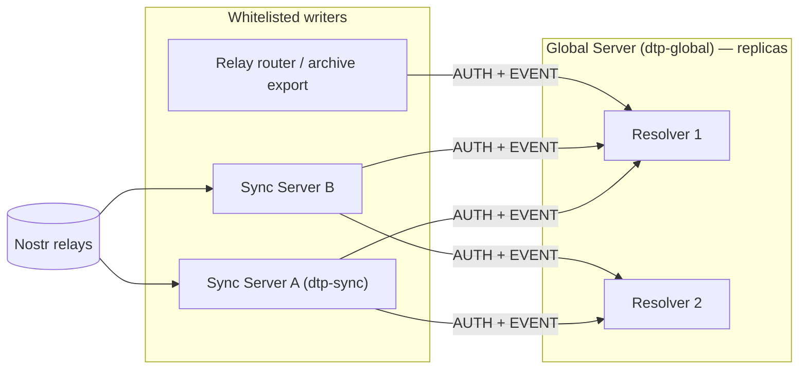

# Global Server — ingest endpoint and Sync Servers

Status: **draft** · 2026-09-30

The Global Server (resolver) does not connect to relays. **Sync Servers**
push events into it through the shared ingest of the resolver protocol —
standard Nostr `EVENT` / `OK` (NIP-01) and `AUTH` (NIP-42), the same ingest
every server has. With the Global setting `auth.writes = members`, only
authenticated pubkeys on the whitelist with the `write` role may push. Any
number of writer connections may be open at once.

A Sync Server can feed a Personal Server the same way; nothing in this
document is specific to the Global Server except that it has no relay sync of
its own.

## Why this split

| Reason | Effect |
| --- | --- |
| Different jobs | The resolver is CPU and memory bound (graph, walks); a Sync Server is network bound (relays) |
| Pluggable data | Anything that can authenticate and publish Nostr events can feed a resolver: our Sync Server, a relay operator's router, a partner's archive export |
| Standard protocol | Writers need no custom client: NIP-01 publishing plus NIP-42 auth |
| Control | The operator decides who may write with a standard whitelist (NIP-43), not with firewall rules |
| Isolation | Relay flakiness, spam bursts, and backfill never share a process with queries |

## Ingest endpoint

Same WebSocket as the resolver protocol
([resolver-api.md § Ingest](../../TrustGraph/specs/resolver-api.md#ingest-event)).

1. On connect the server sends `["AUTH", <challenge>]`.
2. The writer answers with a kind `22242` event signed by its pubkey
   (NIP-42); the server answers `OK`.
3. The writer sends `["EVENT", <event>]` for kinds `32009`, `32014`, `10011`,
   and NIP-09 kind `5` deletions that target them.
4. The server answers each with `OK`:

| `OK` | Meaning |
| --- | --- |
| `true, ""` | Accepted as the new winner of its slot |
| `true, "duplicate: …"` | Already stored, or older than the stored winner |
| `false, "auth-required: …"` | The connection has not authenticated |
| `false, "restricted: …"` | The pubkey is not a member with role `write` |
| `false, "invalid: …"` | Bad id, signature, or NIP-32009 / NIP-32014 / NIP-39 rules |
| `false, "blocked: …"` | Kind or scope not accepted, or the event was deleted (NIP-09) |
| `false, "rate-limited: …"` | Writer over its quota |

- Every event is validated fully; being whitelisted only allows a writer to
  deliver, never to skip validation.
- Several writers may deliver the same event; it is deduplicated by id.
- Backpressure: at most 5 000 events per connection may wait for `OK`; the
  server then stops reading the socket. Writers slow down by TCP, no custom
  flow control is needed.
- A writer keeps its own position (what it has pushed). After a reconnect it
  may push again from an earlier point; duplicates are rejected cheaply
  before signature verification.

## The whitelist

A NIP-43 membership list: kind `13534` signed by the server's `self` key
(NIP-11), with `["member", <pubkey>, "write"]` tags, managed with NIP-86
(`allowpubkey`, `assignrole`, …) by operator pubkeys or with the CLI
([api-privacy-operations.md § Authentication](api-privacy-operations.md#authentication)).
On a Global deployment writing is whitelisted (`auth.writes = members`) even
when reads are open.

Later the whitelist source `wot` will derive members from the operator's web
of trust; writers will then be admitted because the operator's network trusts
them.

## Optional demand hints

Most of the time the resolver needs nothing specific: it keeps every eligible
event it receives on disk ([ingest-storage.md](ingest-storage.md)). When it
does miss something (a new root's authors that no writer has pushed yet, or a
strict-mode candidate's `10011`), it sends writers that subscribed to the
`want` topic a push:

`["DTP-PUSH", "want", { "demandId", "authors"?, "ids"?, "kinds" }]`

A Sync Server that supports it fetches those from relays and pushes them with
ordinary `EVENT`s. Writers that do not subscribe never see it; generic Nostr
tools ignore it.

## Sync Server (`dtp-sync`)

The reference writer, a separate binary in this workspace (decision GS-D6).

| Part | Behaviour |
| --- | --- |
| Relay pool | Author-unfiltered live subscriptions for `32009`, `32014`, `10011`, and kind `5` deletions targeting them (`#k` filter) (`since = now − overlap`); `until`-paginated backfill per relay with durable cursors; NIP-77 negentropy with relays that support it; NIP-11 limits; per-relay health and backoff |
| Pre-filter | Kind allowlist, size, duplicate ids, id hash and signature (`dtp-model`), so obvious junk is dropped before it costs the resolver anything |
| Targets | One or more resolver WebSocket URLs (Global or Personal — the ingest is the same); one authenticated connection per target; its own pubkey is the writer identity |
| Position | Per-target cursor of what has been acknowledged with `OK`; resumes after reconnect |
| Demand | Answers `want` pushes with author-filtered relay fetches (20 authors per REQ), rate-limited |
| State | A small local store for relay cursors and per-target positions; no archive is required |
| Config | `dtp-sync.toml`: relays, backfill policy, targets, signing key reference |
| Telemetry | The shared admin pages on `127.0.0.1:<port>` ([TrustGraph telemetry.md](../../TrustGraph/specs/telemetry.md)): Sources (relays), Ingest (per target: pushed, `OK` results, backlog), Memory, Logs |

One Sync Server can feed many resolver replicas, and a resolver can take
several Sync Servers for redundancy.
